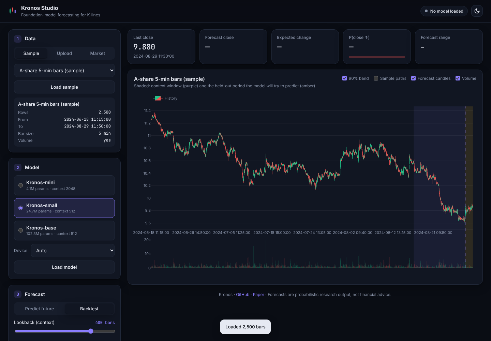

# Kronos Studio

A web UI for forecasting candlestick (K-line) data with the [Kronos](../README.md) foundation models.



## Features

- **Three data sources** — the bundled sample, your own CSV/Parquet/Feather (drag & drop), or any Yahoo Finance ticker (`AAPL`, `BTC-USD`, `EURUSD=X`, …).
  Column names are matched flexibly (`date`/`timestamp`/`time`, `open`/`high`/`low`/`close`, optional `volume`/`amount`).
- **All public models** — Kronos-mini (2048 context), Kronos-small, Kronos-base. Auto-selects CUDA / Apple MPS / CPU.
- **Predict the future** or **backtest** — pick any forecast origin in history and compare the forecast to what actually happened
  (MAE, RMSE, MAPE, direction accuracy, 90% band coverage).
- **Probabilistic output** — runs N independent sample paths and shows 50%/90% bands, individual paths, P(close ↑),
  plus forecast OHLC candles and volume.
- Interactive Plotly chart (zoom/pan/hover), forecast table, CSV export, light/dark theme, works on mobile.
- Plotly is bundled locally, so the page needs no CDN.

## Run

From the repository root:

```bash
pip install -r studio/requirements.txt
python studio/server.py          # or ./studio/run.sh   (Windows: studio\run.bat)
```

Open <http://127.0.0.1:7860>. Use `--host 0.0.0.0 --port 8080` to expose it on your network.

The first forecast downloads the selected model and tokenizer from Hugging Face (`NeoQuasar/*`, ~20–400 MB) and caches them.

## Tips

- **Lookback** is capped to the model's context (512 for small/base, 2048 for mini).
- Each sample path is a full autoregressive run, so time scales with *paths × horizon*. On CPU start with
  Kronos-mini or Kronos-small, 5 paths and a horizon ≤ 60; a GPU is much faster.
- Set a **seed** in *Sampling options* for reproducible results. Lower **temperature** / **top-p** gives tighter, less diverse paths.
- For "future" mode, forecast timestamps are spaced by the median bar interval of your data (market closures are not modelled).

Forecasts are probabilistic research output, not financial advice.

## API

The UI is a thin client over a JSON API you can call directly:

| Endpoint | Body | Purpose |
|---|---|---|
| `GET /api/status` | – | models, loaded model, devices |
| `POST /api/model/load` | `{model, device}` | preload a model |
| `POST /api/data/sample` | `{sample}` | load bundled sample |
| `POST /api/data/upload` | multipart `file` | upload a dataset |
| `POST /api/data/market` | `{symbol, interval, period}` | fetch from Yahoo Finance |
| `POST /api/predict` | `{dataset, model, mode, lookback, pred_len, end_index, samples, temperature, top_p, top_k, seed}` | run a forecast |
